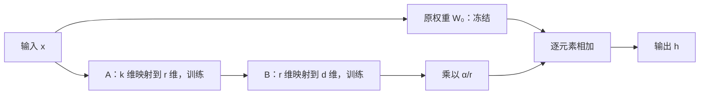

# LoRA：大语言模型的低秩适配

## 论文信息

- **英文标题**：LoRA: Low-Rank Adaptation of Large Language Models。
- **作者**：Edward J. Hu、Yelong Shen、Phillip Wallis、Zeyuan Allen-Zhu、Yuanzhi Li、Shean Wang、Lu Wang、Weizhu Chen；论文署名机构为 Microsoft Corporation，前两位为共同第一作者。
- **年份**：2021 年；首次提交于 2021-06-17，本次阅读的 v2 修订于 2021-10-16。
- **来源**：[arXiv v2](https://arxiv.org/abs/2106.09685v2)。本笔记以用户提供的本地 26 页 PDF 为依据，页码指该 PDF 页码；版本日期经 arXiv 页面核对。
- **作者代码**：[microsoft/LoRA](https://github.com/microsoft/LoRA)，链接来自论文，本文未审核当前仓库实现。

**一句话解读**：已有预训练能力的模型，在适配一些具体任务时，可能只需学习少量共同变化的方向。LoRA 冻结原权重，用两个小矩阵表示权重增量，以很少的可训练参数实现任务适配，并允许在部署前合并权重。

## 研究背景与动机

大模型预训练后，通常还需要针对分类、摘要、自然语言转 SQL 等任务进行微调。全量微调（full fine-tuning）允许所有参数变化，但要为它们保存梯度和 Adam 优化器状态；每个任务还可能需要保存一份完整模型。GPT-3 175B 使用半精度存储时，仅一份模型权重就约为 350 GB，多个任务的独立副本很快会产生很高的存储和部署成本。

既有参数高效微调（parameter-efficient fine-tuning）方法降低了任务专属参数量，但各有取舍。论文比较的 Adapter 在网络中插入带非线性的串行模块，可能增加推理延迟；前缀微调（prefix tuning）学习虚拟 token 或各层对应表示，使用额外序列位置，并在本文设置下出现优化困难。作者希望同时保留任务质量、小规模任务参数和原有推理计算结构。

研究动机来自“内在维度”（intrinsic dimension）较低的相关工作。但低内在维度与低矩阵秩是不同概念，前者只能启发后者，不能直接证明后者。论文因此提出一个待实验检验的假设：任务适配所需的权重变化，可以用低秩结构有效表示。

## 主要贡献

LoRA 的关键设计是对**权重增量**施加低秩参数化：保留预训练矩阵不变，直接训练两个小矩阵的乘积。它不需要先完成一次昂贵的全量微调，再把得到的增量做奇异值分解（singular value decomposition，SVD）；也没有把原始模型权重压缩成低秩矩阵。

论文的贡献还包括：在 RoBERTa、DeBERTa、GPT-2、GPT-3 上验证这种设计的任务质量和资源收益；研究应该适配哪些注意力矩阵、秩如何影响效果；通过子空间分析提出“适配可能放大预训练中已有但不突出的任务相关方向”的解释。后者属于经验性机制解释，不是普适理论或因果证明。

## 方法论

### 1. 核心公式：只学习一个低秩增量

对于线性层，设输入为列向量：

\[
W_0\in\mathbb{R}^{d\times k},\qquad h=W_0x.
\]

全量微调直接优化一个大小为 \(d\times k\) 的自由增量 \(\Delta W\)。LoRA 则采用：

\[
\Delta W=sBA,\qquad
B\in\mathbb{R}^{d\times r},\quad
A\in\mathbb{R}^{r\times k},\quad
s=\frac{\alpha}{r},\quad r\ll\min(d,k).
\]

因此前向计算为：

\[
\boxed{h=W_0x+\frac{\alpha}{r}B(Ax).}
\]

论文式（3）先省略缩放因子写成 \(W_0x+BAx\)，随后在正文说明使用 \(\alpha/r\) 缩放；这里把它显式写出。训练时只有 \(A,B\) 更新，\(W_0\) 保持冻结。

这里的低秩约束针对每个被适配的权重矩阵，并不意味着整个多层非线性模型只能实现秩为 r 的函数。合并后的 \(W_0+sBA\) 也仍然可以是满秩矩阵。

### 2. “低秩”为什么能减少参数

把 \(B\) 的列记作 \(b_i\)，把 \(A\) 的行记作 \(a_i^\top\)，则：

\[
BA=\sum_{i=1}^{r}b_i a_i^\top,
\qquad
BAx=\sum_{i=1}^{r}b_i(a_i^\top x).
\]

每一项根据输入沿某个方向的投影，给输出添加一个方向上的修正。r 表示最多允许多少个这样的独立修正方向。r=1 仍能影响矩阵中的所有位置，只是这些变化受到一个外积结构的共同约束；它不是只更新一个神经元。

一个矩阵的可训练参数从 \(dk\) 变为 \(r(d+k)\)。对方阵为 \(d^2\to2dr\)，比例为 \(2r/d\)。例如 \(d=4096,r=8\)：

- 全量更新：16,777,216 个参数。
- LoRA：65,536 个参数，占该矩阵参数量的约 0.39%，减少 256 倍。

这只是单个矩阵的对比。若整个模型只对少数矩阵使用 LoRA，可训练参数占模型总参数的比例还会更小。

### 3. 初始化为什么一边随机、一边为零

论文将 \(A\) 用随机高斯分布初始化，将 \(B\) 初始化为零。因此训练开始时 \(BA=0\)，模型的初始前向行为与预训练模型一致。

一个可由公式直接推导的细节是：若单个样本的上游梯度为 \(g=\partial\mathcal{L}/\partial h\)，则

\[
\frac{\partial\mathcal L}{\partial B}=s\,g(Ax)^\top,
\qquad
\frac{\partial\mathcal L}{\partial A}=s\,B^\top g x^\top.
\]

在初始 \(B=0\) 时，B 一般能获得非零梯度，A 的任务损失梯度暂时为零；B 更新后 A 也能开始学习。若两者都置零，双线性分支的任务损失梯度会同时为零，无法启动。这一解释是数学推导。

\(\alpha/r\) 用来调节增量分支的尺度。论文希望减少改变 r 时重新调参的需求，但这不保证不同 r 的训练动态完全相同。附录中不同实验的 α 设置也不同，例如 GPT-2 使用 r=4、α=32，不能把 α 等于 r 当作强制规则。

### 4. 放在 Transformer 的哪里

论文主要将 LoRA 应用于自注意力的查询、值投影矩阵 \(W_q,W_v\)，并在消融中比较 \(W_k,W_o\) 和更多矩阵的组合；原文主要实验冻结前馈网络（MLP）。该方法在形式上能应用到其他线性层，但这篇论文没有系统验证 MLP 适配。

从注意力机制看，改变查询投影会影响注意力分配，改变值投影会影响被聚合的内容。这是便于理解的机制说明；“某个组合最优”仍需要看具体实验，不能仅靠这一直觉推断。

### 5. 为什么合并后不增加推理计算

部署前可以计算：

\[
W_{\mathrm{merged}}=W_0+\frac{\alpha}{r}BA.
\]

此后直接执行 \(h=W_{\mathrm{merged}}x\)，线性层的形状和正常模型相同，不再计算独立的 A、B 分支。这解释了本文“无额外推理延迟”的结构性依据：它依赖权重合并，合并本身是部署或切换阶段的操作。

若保留独立分支以便动态切换不同任务，则仍有额外计算；若把某一任务增量合并进共享权重，同一批次混合不同任务的请求就不直接适用。原文第 5 页明确讨论了这一限制。

### 6. 训练为什么省显存，却不按参数比例加速

主要省掉的是冻结权重对应的梯度和优化器状态，以及任务检查点存储。基座权重仍需加载，前向传播仍需执行，而且通常仍需通过冻结层向较早的 LoRA 模块反传梯度并保存所需激活。长序列、大批次的激活开销也不会因为 LoRA 自动消失。

因此，应区分可训练参数量、任务文件大小、训练峰值显存、训练吞吐量这四个指标。它们的改善幅度不会相同。

## 实验结果

### 1. 实验覆盖和评价口径

- RoBERTa base/large、DeBERTa XXL：GLUE 自然语言理解任务。
- GPT-2 medium/large：E2E、WebNLG、DART 数据到文本生成任务。
- GPT-3 175B：WikiSQL 自然语言转 SQL、MNLI 文本蕴含、SAMSum 对话摘要。

GPT-3 主表中 WikiSQL 使用逻辑形式验证准确率，不能等同于 SQL 执行准确率；MNLI-m 是 matched 验证集准确率。表 4 对 SAMSum 报告 ROUGE-1/2/L，附录 C 写其使用 819 条测试样本；附录 D.4 又概述报告最佳验证结果。原文此处对选择集与最终报告集的文字并不完全清晰，因此不应把整张表一概称为独立测试集成绩。

### 2. 小参数能否保留任务质量

下表为表 2、表 3 的部分结果；M 表示百万参数，分数越高越好。

| 模型与任务 | 全量微调可训练参数 | LoRA 可训练参数 | 全量微调分数 | LoRA 分数 |
|---|---:|---:|---:|---:|
| RoBERTa base，GLUE 平均 | 125.0M | 0.3M | 86.4 | 87.2 |
| RoBERTa large，GLUE 平均，非 † 配置 | 355.0M | 0.8M | 88.9 | 89.0 |
| DeBERTa XXL，GLUE 平均 | 1500.0M | 4.7M | 91.1 | 91.3 |
| GPT-2 medium，E2E BLEU | 354.92M | 0.35M | 68.2 | 70.4±0.1 |
| GPT-2 large，E2E BLEU | 774.03M | 0.77M | 68.5 | 70.4±0.1 |

GLUE 平均分混合了不同任务指标，并非单一准确率；很多全量微调基线引用先前工作。RoBERTa 部分任务还使用 MNLI 迁移初始化，† 行则采用受限配置以对齐 Adapter 比较，LoRA large 在该配置下平均为 88.6。应理解为“极少参数可以保留有竞争力的质量”，不宜把所有微小分差都视为严格的显著优势。

### 3. GPT-3 175B 的主要结果

原文表 4，第 8 页：

| 方法 | 可训练参数 | WikiSQL 准确率 | MNLI-m 准确率 | SAMSum ROUGE-1/2/L |
|---|---:|---:|---:|---:|
| 全量微调 | 175,255.8M | 73.8 | 89.5 | 52.0 / 28.0 / 44.5 |
| Adapter H | 40.1M | 73.2 | 91.5 | 53.2 / 29.0 / 45.1 |
| LoRA | 4.7M | 73.4 | 91.7 | 53.8 / 29.8 / 45.9 |
| LoRA | 37.7M | 74.0 | 91.6 | 53.4 / 29.2 / 45.1 |

4.7M 约占 175.3B 的 0.0027%。该参数预算的最佳具体配置可能因任务而异；附录允许只适配 V 或适配 Q、V 等选择，不应默认整行都对应完全相同的矩阵配置。

论文报告的随机种子波动约为：WikiSQL ±0.5 个百分点，MNLI-m ±0.1 个百分点，SAMSum 三项分别 ±0.2/±0.2/±0.1。73.4 与 73.8 更适合描述为接近；74.0 与 73.8 的差值也很小。MNLI-m 和 SAMSum 的结果则显示出较明确的数值提升。GPT-3 未对每格分别报告多种子误差。

### 4. 资源收益及其条件

原文第 5 页给出的 GPT-3 175B 案例：

| 指标 | 全量微调 | LoRA | 应如何理解 |
|---|---:|---:|---|
| 训练显存 | 约 1.2 TB | 约 350 GB | 约降至三分之一，基座权重仍存在 |
| 每个任务的权重存储 | 约 350 GB | 约 35 MB | 此处为 Q、V 使用 r=4 的近似数字 |
| 每 V100 的训练吞吐 | 32.5 token/s | 43.1 token/s | 吞吐提高约 32.6%，相同 token 数的时间减少约 24.6% |

摘要中的“减少一万倍”主要对应参数或任务权重存储的数量级。不能将表 4 的 4.7M 配置、此处 r=4 的存储示例和全部资源数字当作同一次配置下的统一测量。

还需注意：35 MB 是任务增量文件，不是整个 GPT-3 模型；部署仍需约 350 GB 的基座。文中以 100 个任务为例，共享基座加 100 份增量约 354 GB，而保存 100 份完整模型约需 35 TB。实际资源收益依赖精度、优化器、序列长度、批大小和并行方案。

推理方面，表 1 在 Quadro RTX8000 上测 GPT-2 medium 的单次前向，100 次取平均。批大小 1、序列长度 128、Adapter 参数预算 11M 时，基线为 19.8±2.7 ms，Adapter L 为 23.9±2.1 ms，Adapter H 为 25.8±2.2 ms；较大批次下额外延迟比例明显减小。这是特定前向场景，不能视为所有生成服务端到端延迟的固定增幅。

### 5. 同样的参数预算应该花在哪里

表 5 固定 GPT-3 总可训练参数约 18M，在全部 96 层比较：

| 适配矩阵 | 每矩阵秩 | WikiSQL | MNLI |
|---|---:|---:|---:|
| 仅 Q | 8 | 70.4 | 91.0 |
| 仅 V | 8 | 73.0 | 91.0 |
| Q、V | 4 | 73.7 | 91.3 |
| Q、K、V、O | 2 | 73.7 | 91.7 |

它支持的经验是：在这些任务和预算下，把较小的秩分配到多个投影矩阵，可能比只提高单一矩阵的秩更有效。Q、V 是有效选择，但并非表中所有任务的唯一最优组合；四种矩阵组合在 MNLI 上更好。

### 6. 秩越大是否越好

表 6 在 GPT-3 的 Q、V 上比较 r：

| r | 1 | 2 | 4 | 8 | 64 |
|---|---:|---:|---:|---:|---:|
| WikiSQL | 73.4 | 73.3 | 73.7 | 73.8 | 73.5 |
| MNLI | 91.3 | 91.4 | 91.3 | 91.6 | 91.4 |

很小的 r 已有较好效果，继续增加并未稳定改善结果。附录表 18 的 GPT-2 medium 上，E2E BLEU 在 r=4 时为 70.38，高于 r=1 的 68.72 和 r=64 的 69.24。该附录也承认部分超参数按 r=4 调过，未必对其他 r 最优。

因此，“r=1 已经够用”是部分模型、任务、插入位置下的观察；不是所有任务的默认定理，也不能仅凭模型总参数量确定 r。

### 7. 低秩分析到底说明了什么

第 7.2 节比较 r=8、r=64 或不同随机种子训练得到的 A 的主要奇异向量子空间。作者用归一化投影重叠衡量相似度：接近 1 表示高度重叠，接近 0 表示近乎正交。主要方向更容易重复出现，而次要方向重叠较少。作者据此解释：真正有用的方向可能不多，增加的方向中可能包含更多训练噪声。

这是与低秩有效性一致的证据，但其限制是：分析对象本来就经过低秩参数化，而且 A、B 的分解不唯一；它不等于直接证明任意全量微调的最优增量都严格低秩。更稳妥的结论是：这些适配任务存在质量很好的低秩更新方案。

第 7.3 节进一步比较增量与原权重。以 GPT-3 第 48 层查询矩阵、r=4 为例，原权重在增量奇异方向上的投影范数为 0.32，在原权重自身前四个奇异方向上的投影范数为 21.67，随机方向为 0.02；增量范数为 6.91，因此作者定义的放大比值约为 6.91/0.32≈21.6。

作者的解释是：增量选择的方向与原权重有联系，但并非原权重最强的那些方向，适配可能放大原有的、任务相关而原先不突出的特征。这里的“约 20 倍”是投影范数比，不是整个权重矩阵扩大 20 倍，更不是性能提高 20 倍；特征的具体语义也未通过这项分析得到直接证明。

### 8. 补充观察

附录表 16 在 GPT-3 的 MNLI 训练子集上报告：100 条样本时，全量微调为 60.2，LoRA 为 63.8；1k 条时为 85.8 与 85.6；10k 条时为 88.9 与 89.2。这说明它在本文少样本设置下有竞争力，但不能推出少样本时必定胜出。

附录 E、表 15 还显示，LoRA 可以与前缀嵌入微调组合：WikiSQL 上较大参数配置达到 76.2，而全量微调为 73.8。组合同时改变了参数预算，不宜把它当作纯粹等预算收益；与前缀层微调的组合也没有稳定提升。

## 局限性

1. **低秩是任务适配的归纳偏置，不是普遍保证。** 强领域迁移、不同语言或更复杂的目标可能需要更多方向；作者在第 10 页脚注明确提醒小 r 不适用于所有数据和任务。
2. **插入位置与秩仍靠经验选择。** 原文重点研究注意力矩阵，没有系统覆盖 MLP、所有层与任务的分配策略；矩阵覆盖范围可能和 r 同样重要。
3. **高效训练不等于小模型推理。** 基座大小不变，合并后的矩阵大小不变，基础推理计算量也不因 LoRA 自动减少。它主要解决任务适配成本。
4. **显存节省存在下限。** 基座权重、激活与反向传播仍有成本。本文没有以量化基座作为方法前提，也不能从原文推导出任意硬件上的固定显存降幅。
5. **合并与多任务混合服务存在取舍。** 合并便于使用普通推理路径，但共享一次前向中的同一权重时，不能直接承载每个样本各异的已合并增量；保留分支会引入额外工作。
6. **基线与评价口径需要仔细阅读。** 有些基线来自既有论文；初始化、训练设置、误差报告和验证集选择并非完全统一。结果能支持方法有效，不能支持 LoRA 在所有任务都必然胜过充分调优的全量微调。
7. **机制解释仍有限。** 子空间重叠和投影范数分析提供线索，但没有证明低秩足够的完整原因，也没有证明原始预训练权重本身可直接低秩替代。

## 核心要点

- **记住对象**：LoRA 对权重的任务增量做低秩参数化，冻结的基座仍完整保留。
- **记住公式**：\(h=W_0x+(\alpha/r)BAx\)，用 \(r(d+k)\) 个参数表示对 \(dk\) 个权重的结构化修正。
- **记住工程条件**：节省的主要是训练状态和任务文件；“无额外推理延迟”来自提前合并权重。
- **记住实验证据**：多个模型和任务显示极少参数即可保留质量；秩与插入位置需要结合任务选择，更多参数不一定更好。
- **记住结论边界**：论文展示了一些高质量的低秩适配方案，尚未证明所有任务的最优微调更新都低秩。

建议复读顺序：第 4 页公式与初始化 → 第 5 页资源收益及限制 → 第 8 页 GPT-3 主实验 → 第 10 页矩阵位置与秩消融 → 第 11～12 页机制分析 → 第 26 页 GPT-2 的不同秩结果。
