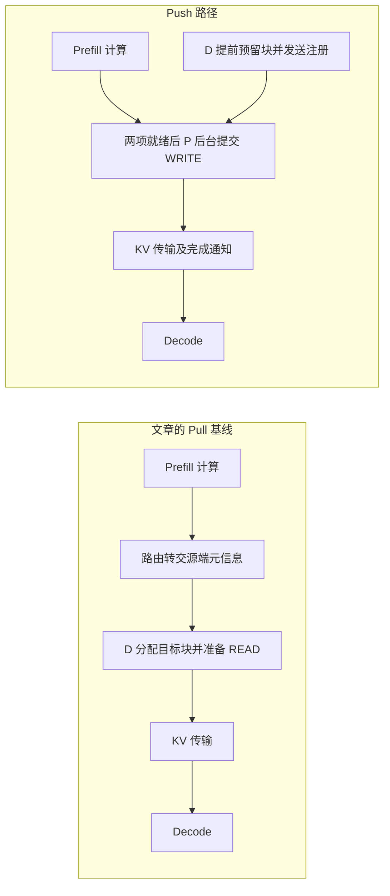

# Push-Based KV Transfer to Improve TTFT and TPOT for Disaggregated Inference in vLLM：中文工程解读

## 基本信息与证据范围

- 类型：vLLM 官方工程博客，非学术论文。
- 作者：Sunita Nadampalli（AWS）、Nicolò Lucchesi（Mistral）。
- 发布／页面标注更新日期：2026-10-14；阅读核验：2026-10-19。
- [原文](https://vllm.ai/blog/2026-10-14-nixl-push-connector)。
- [v0.29.0 设计文档](https://docs.vllm.ai/en/v0.29.0/design/nixl_kv_push_connector/)。本文采用与博客实验对应的版本，避免把 latest 的新增兼容能力混入实验结论。
- [v0.29.0 worker 源码](https://github.com/vllm-project/vllm/blob/v0.29.0/vllm/distributed/kv_transfer/kv_connector/v1/nixl/push_worker.py)，已读取该 tag 的原始源码。
- [作者给出的 benchmark PR #57567](https://github.com/vllm-project/vllm/pull/57567)。博客引用 PR 分支，未将其当作固定不可变提交。

除明确标注“推断”“建议”或“教学示例”的部分外，机制来自上述一手资料。性能数字为作者公开实测，本文没有进行独立硬件复现。

## 核心结论

这篇文章优化的是 P/D 分离推理中 KV 交接的时序，以及传输准备工作对 Decode 主循环的干扰。核心有两点：

1. 在 Prefill 计算期间，Decode 就预留目标 KV blocks，并将目标位置通知 Prefill；使这部分工作与 Prefill 重叠。
2. Prefill 在后台线程准备描述符并提交 NIXL WRITE，让 Decode 主循环继续执行已有请求的生成迭代。

两种模式仍使用相同的 NIXL、EFA/RDMA 数据路径。文章没有证明 WRITE 原语天然比 READ 更快，也没有通过压缩或量化减少 KV 字节数，更没有改变 attention 计算。

## 问题背景：P/D 分离后，网络以外的开销也会进入关键路径

P（Prefill）处理输入并产生 KV；D（Decode）读取这些 KV，逐 token 生成。文章比较的 Pull 基线，在 P 完成后才通过路由传递源端元信息，随后由 D 分配目标块、准备传输描述符、提交 READ。

因此，新请求的首 token 不仅等待 Prefill 和数据传输，还等待交接控制流程。更隐蔽的问题是：D 为新请求准备传输时，如果相关工作在引擎主循环内同步执行，已在 D 上生成的其他请求也会受到影响。

下图是时序示意，箭头不表示精确耗时：

忽略排队、路由细节和部分握手开销的教学模型：

- Pull：`T_prefill + T_后置协调及准备 + T_KV传输 + T_开始生成`。
- Push：`max(T_prefill, T_D提前准备) + T_P剩余提交 + T_KV传输 + T_开始生成`。

这个模型说明“串行变重叠”，不用于拟合文章的 3 倍收益。高负载时排队、主循环阻塞和调度反馈也会放大差异。冷连接握手、后台提交和完成通知仍可能留在关键路径上。

## 优化点一：D 提前准备接收位置

请求尚在 P 上计算时，D 已选定，D scheduler 为它预留 KV blocks，并生成注册信息；worker 后台将注册经 NIXL notification 发给 P。

注册包含请求 ID、D engine/host/port/TP 信息以及目标逻辑 block IDs。这是请求级“告诉 P 应写到哪里”；不应等同于每请求重新进行底层 RDMA 物理内存注册。worker 建立及注册 KV cache 是另一层资源管理。

P 上有两个条件：本地 Prefill KV 已就绪；远端 D 注册已到达。两者到达顺序不固定，先到的一方暂存，另一方到达后触发 WRITE。

重要边界：重叠的是 D 接收准备与 P 计算。文章没有实现或证明同一请求的逐层 KV 边算边传，也不能据此称为 layerwise streaming。

## 优化点二：把传输准备从 D 主循环移走

博客描述后台工作包括建立或复用连接、把 block IDs 映射成地址描述符、合并连续区域、提交 WRITE。D 不再在新请求到达时内联执行原基线的那组 READ 准备工作。

为什么这会降低 TPOT？假设 D 正在给请求 A、B 生成，新请求 C 此时需要接收长 prompt 的 KV。若主循环为了 C 构造、提交大量描述符，A、B 的下一次 decode 迭代就可能推迟。即使 GPU 上单次 decode kernel 完全没有加速，A、B 的 token 间隔也能因这些间隙减少而改善。这是机制解释，不是本文测得的独立耗时分解。

v0.29.0 源码显示：

- 每个 worker／TP rank 启动 `nixl-push-writer`；P、D 两侧均有该机制。
- D 主线程将注册放入 `_reg_send_inbox`；P 将完成的块放入 `_finished_blocks_inbox`，主线程继续执行。
- writer 接收 `PUSH_REG`，进行匹配，提交 WRITE；其他完成通知通过队列交回主线程处理。
- D→P、P→D 握手在后台 executor 执行，握手完成后用 callback 重新入队；writer 不同步等待网络握手。
- 无工作时通过 Event 等待；存在尚未匹配注册的 P 完成块时，以 1 ms 间隔自轮询。不能描述成持续无条件忙轮询。

后台线程没有消除 D 分配块、维护请求状态、处理完成通知等工作，也不能自动消除 CPU/GIL、PCIe、HBM 或网卡带宽竞争。

## 优化点三：连续区域合并与连接复用

文章还描述将连续 blocks 合成较大的传输区域，并复用已建立的 NIXL 连接。这样可以减少每次交接的描述符和连接准备负担。

应将其视为实现细节，而非作者单独证明的收益来源：博客没有给出逐项消融，也未证明这些能力全部是 Push 独有。不能把 TTFT 的全部改善归给 block 合并。

对异构平台的启发是：即使大块 device-to-device 带宽已足够，小块多描述符的 CPU 提交开销仍可能成为瓶颈。需要分别测量 descriptor 数量、构造时间、提交时间、实际传输时间和引擎迭代间隙。

## 协议正确性：收到通知后才能开始 Decode

P 将 KV WRITE 到对应 D TP ranks。D 统计预期写入它的 producer ranks 的完成通知，全部到齐才把该请求视为 KV 可用。一个 WRITE 已提交，不代表整个请求已可生成。

请求匹配、源块租约、目标块生命周期和完成计数属于正确性条件。v0.29.0 文档还区分：D 注册 watchdog 清理过期注册状态，并不独自完成 HTTP 请求的失败退出；最终请求失败仍需要引擎 abort 或代理超时路径。故障恢复不能只测试“日志出现 timeout”。

## 作者公开实测：条件和结果

### 实验条件

| 维度 | 原文披露 |
| --- | --- |
| 拓扑与硬件 | 1P1D，两台 `p5en.48xlarge`，每台 8× NVIDIA H200，共 16 卡；另设代理／客户端节点 |
| 并行 | P、D 各 TP8；该结果未覆盖多 P、多 D 扩展 |
| 模型与精度 | Qwen3-32B，`--dtype bfloat16`；模型 revision、KV dtype 未单独明确 |
| 版本 | vLLM 0.29.0、NIXL 1.4.1、Python 3.12 |
| 系统 | Ubuntu 24.04.4，kernel 6.14.0-1018-aws，driver 580.126.16，CUDA toolkit 13.0 |
| 网络 | 同 AZ 的 AWS EFA；每节点 16×200 Gb/s，标称合计 3.2 Tb/s；每 GPU 的 KV 注册到 2 条 PCIe 本地 rails，未设额外设备覆盖 |
| 网络软件 | EFA installer 1.50.0、libfabric 2.6.0amzn1.0、rdma-core 64.0amzn0 |
| 工作负载 | 输入 1k–16k tokens，输出 128 tokens，请求到达率 1–8 QPS |
| 服务参数 | max-model-len 32768，max-num-seqs 8；D 禁用 prefix caching，每请求传完整 prompt KV |
| 基线 | Pull `NixlConnector` 对比 Push `NixlPushConnector`，配套使用各自代理 |

8 QPS 是每秒发起 8 个请求；`max-num-seqs=8` 是引擎调度参数。二者单位和作用不同，数值恰巧相同，不表示客户端并发固定为 8。

### 关键结果

| 条件 | Pull | Push | 解释 |
| --- | --- | --- | --- |
| 16k 输入、128 输出、8 QPS：TTFT | 约 1744 ms | 约 540 ms | 作者概括最高约 3 倍改善；按约数计算延迟下降约 69% |
| 16k 输入、128 输出、4–8 QPS：TPOT | 约 10.4 ms | 约 7 ms | 作者概括最高约 30% 改善；非单独 kernel 加速 |
| 轻负载 TPOT | 约 5.6–5.8 ms 范围 | 接近 Pull | 低负载、短 prompt 时收益很小 |

以上均为作者公开实测，非独立复现。博客叙述未明确这些绘图数值的统计聚合口径，不能当作 P99；未公开可在此直接引用的完整绝对输出／总 tokens/s 数据，不能把 TTFT 加速比当吞吐加速比。128-token 输出的结果也不能直接外推至 1k-token 输出。

作者说最初在 Trainium/EFA 集群开发验证，然后贡献为 accelerator-agnostic 功能；博客量化展示的是 H200/EFA，未披露同条件 Trainium 对比。这不证明任意国产设备已可直接使用该实现。

## 因果解释与适用边界

实验同时改变了提前注册、传输发起端和后台线程安排。因此，公开数据证明的是这套 Push 路径相对所测 Pull 基线的整体收益，不能孤立证明 WRITE 比 READ 快。

文章提到探索把后台线程模型加入 Pull 的 [PR #45211](https://github.com/vllm-project/vllm/pull/45211)。本文仅按博客说明记录该探索，不据此断言其合并或发布状态。

主要权衡：

- D 必须更早选定，路由器失去等 Prefill 完成后再按最新负载选 D 的部分灵活性。
- D 提前预留 KV slots，等待期间占用容量；这是块池中的容量占用，不等于新增或减少同等字节的物理显存分配。
- P 可能更早完成交接并回收源块，但前提是对端和传输按时完成；源块不能在 WRITE 完成前复用。
- Prefix 命中率高、短输入、低到达率时，实际需要传输的 KV 或主循环干扰较少，收益可能缩小。
- 若瓶颈是链路带宽、host staging 或设备计算，本优化能移除的仅是协调与准备开销。
- 博客建议需要双向 KV 传输或必须延后选择 D 的工作负载继续考虑 Pull。不要默认 Push 与其他双向方案无修改即可组合。
- KV 布局、block 大小、TP/PP 组合须按精确版本验证；“异构加速器”“异构 TP”“不同 KV 布局”是不同兼容性问题。

## 面向异构加速器测试与优化的验证建议

下列均为建议，未执行硬件实验，也不是文章已有结果。

### P0：先确认主循环是否被传输准备阻塞

依赖：可用的 P/D 引擎、设备对应 NIXL backend 或等效通信路径、CPU／设备 tracing。

最小实验：固定模型、精度、拓扑、cache 状态和请求流，对比 Pull／Push。用长输出请求维持 D 持续生成，同时注入需要新 KV 的请求，观察已有请求的 ITL 波形。

建议输入／输出使用 4k/1k、16k/1k；先测固定并发 1、4，再测 64。另做独立的到达率扫描，不把 QPS 扫描与固定并发混为同一控制条件。若将 max-num-seqs 从文章的 8 改为其他值，须在报告中明确。

记录：D 每步耗时、CPU 描述符准备及提交耗时、设备 kernel 间隙、传输队列等待、TTFT、TPOT、P99 ITL、输出 tokens/s、失败率。在同一负载下仍需确认吞吐和延迟没有互相置换。跨主机时间线需要时钟同步或分布式 tracing，不能直接相减不同主机的 monotonic timestamp。

预期：如果主要开销是 D 主循环里的传输准备，可减少 token 间隙；若主要受实际链路带宽限制，改善可能有限。不预设 3 倍收益。

### P1：拆开验证“提前注册”和“后台提交”

依赖：具备可插桩、可修改 connector 的实现，或已经支持后台提交的 Pull 版本；文章没有提供一个现成开关就能完成全部消融。

最小对照：原 Pull、仅将 Pull 准备放后台、完整 Push。进一步具备开发条件时，固定传输方向，仅改变提前注册时机，以减少混杂。保持工作负载、连接冷热状态、设备／NIC 亲和性一致。

重点比较冷启动与连接已建立后的稳定期，分别统计 P 就绪到传输提交、提交到完成、完成到首个 decode 步的时间。这样可判断迁移平台更值得先改线程模型，还是先改协议时序。

### P1：检查异构数据路径和异步生命周期

依赖：设备内存注册、远端写入、通知及内存可见性语义受支持；P/D 的 KV 格式、精度、分片及地址映射兼容。

先做 1P1D、相同 TP 的保守配置，再逐步扩展布局和并行组合；检查数据是否走 device-to-device，还是隐式绕经 host。后台线程不能替代这些支持。

正确性对照使用相同 tokenized prompt 和固定采样设置，比较正常 P/D、Push 及单体推理输出；浮点差异按框架和模型允许的容差分析，不能要求不同 batching 下必然逐位一致。必要时对比 KV 内容及首步 logits。

稳定性注入包括取消、重试、抢占、D 内存不足、连接失败、缺少一个 rank 的完成通知。检查不会使用未到齐 KV、不会写入已回收或复用的目标块、不会提前回收源块、请求超时后 P/D 状态及块容量最终恢复。

## 实践判断

最值得借鉴的是把“接收准备”和“计算”重叠，并保护 Decode 主循环的迭代节奏。对正在做异构加速器推理优化的工程师，第一步应是测出传输准备是否造成迭代间隙，再决定是否移植完整 Push 协议。网络峰值带宽测试本身无法替代这个端到端诊断。
