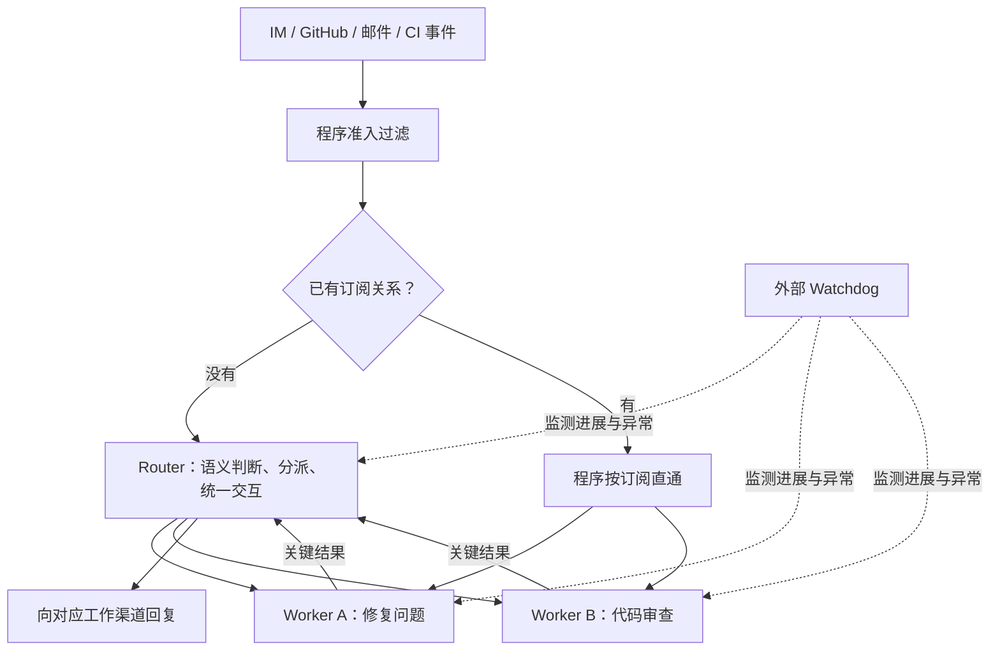

# Super-agent 设计探索：迈向更自主的 Agent 系统：中文工程解读

## 基本信息与证据范围

- 类型：DeepSeek Harness 团队的工程架构探索文章，非学术论文，也不是现有产品功能清单。
- 作者：Yujia Qiao 完成系统实现和文章写作，DeepSeek Harness 团队共同实践并参与讨论。
- 阅读核验日期：2026-11-01；阅读时知乎页面标注编辑于 2026-11-01 10:43。
- [官方原文](https://zhuanlan.zhihu.com/p/2099987320443237060)：已通过浏览器读取全文，以下章节号对应该版本。
- [官方原型仓库](https://github.com/deepseek-ai/dsh-superagent-prototype)：已核对 README，未进行源码审计或部署复现。仓库明确说明，公开版本与内部系统及文章描述并不完全一致，一部分设计仍未实现。

机制及实验数字来自原文；本文的教学示例、工程推断与评价会明确标注。没有独立复现实验，也不将二手报道作为技术结论的依据。

## 1. 核心观点：把多任务管理的负担交给系统

作者关注的瓶颈是：当模型越来越能独立完成任务后，人仍然需要切换聊天窗口、补充背景、同步任务变化、检查是否卡住。Agent 增多之后，人的注意力可能先耗尽。

作者观察到一个人通常只能跟进 3～5 个活跃 Session。这是团队经验观察，不是经受控认知实验验证的人类能力上限。

文章希望用户始终面对一个连续的协作者，而由系统在后台维护多个任务的上下文、并行执行、接收后续消息并恢复异常。其四个目标是：跨渠道保持连续、并行且及时响应、根据环境事件主动行动、长期在线并能恢复。

**我的解读：全文最有价值的转变，是把“用户逐个管理会话”改成“系统管理任务和会话之间的关系”。** 新增价值主要来自组织与运行机制；每个具体任务能否做对，仍取决于模型、工具、环境和验收。

## 2. 先澄清几个词

| 术语 | 本文中的含义 | 容易混淆的地方 |
| --- | --- | --- |
| Harness | 围绕模型的运行系统，承担工具调用、上下文组织、事件和执行管理等职责 | 模型本身只是一部分 |
| Session | 一个持续的模型上下文及其执行历史 | 不必对应用户界面的一个聊天窗口，也不必是一个操作系统进程 |
| Trigger | 一条驱动系统的环境事件，如群消息、评审意见、CI 结果 | 不只包括用户主动给 Agent 的命令 |
| Thread | 具有业务关联的一串事件，如同一个 PR 或同一条邮件往来 | 这里不是 CPU 线程 |
| Worker | 专注执行某个任务的会话或会话组织 | 可以在内部继续使用 Subagent 或 Agent Team |
| Router | 维持跨任务关联、路由及统一对外交互的逻辑层 | 不能简单等同于 HTTP 网关或纯规则分类器 |

## 3. Router / Worker：把协调和执行分开

如果所有事情都进入一个会话，背景容易保持连续，但长任务会阻塞交互，任务细节也会混杂。如果每条新消息都开新会话，并行容易，前后关系却会丢失，还可能出现多个会话同时向人回复。

作者把这两个目标交给不同层处理（原文第 2 节）：

| 层级 | 负责什么 | 配置及约束 |
| --- | --- | --- |
| Router | 理解新消息与已有任务的关系、分派任务、转达关键变化、统一回复 | 尽量保持轻量，不直接做具体工作，甚至可以不配 Bash；作者认为较轻量模型通常够用 |
| Worker | 读代码、调用工具、定位问题、完成单个任务并报告结果 | 上下文彼此隔离，配备执行工具和较强模型；不直接向外部信道输出交互过程 |

下面是依据原文重画的简化图，表示逻辑关系，不是源码部署图：



图中省略了 Router 对全局事件的观测，以及对象存储、链式召回等结构。语义策略依上下文判断是否行动；已有订阅的后续事件不必每次都重新让 Router 执行转发。

与常见 Agent Team 的区别在于协调粒度：Team Lead 往往需要拆解一个复杂任务并协调紧密耦合的子步骤；这里的 Router 主要协调多个任务之间的关系。Worker 内部仍然可以采用 Team。因此两者可以嵌套，不是互斥的技术路线。

**工程解读：设计的重要性在于约束任务分工。** 只告诉主会话“适当使用 Subagent”，主会话仍可能决定亲自执行；当 Router 的职责及工具配置限制了这种行为，长任务就更稳定地进入 Worker。提示词仍有作用，但系统结构减少了对模型临场选择的依赖。

上下文隔离只表示任务不会把全部推理历史混在一起，不自动意味着文件系统、凭据、权限或共享资源已隔离。Router 不配 Bash 也不构成完整的安全保证：如果它能向有权限的 Worker 分派危险工作，风险仍然存在。

## 4. 事件驱动：主动性来自持续输入和路由

### 4.1 两级过滤：稳定判断交给程序

真实群聊大多与 Agent 无关。原文第 3.1 节先用程序检查来源、群组、白名单和响应规则，再让模型判断候选事件的语义及是否需要介入。

- Fast Path：代码能确定的高频判断，开销低、行为稳定。
- Slow Path：需要理解意图和上下文的判断，交给模型。

这是一种成本分配方式。主动性依赖监听事件、过滤规则和可执行策略共同支撑；它不要求模型无输入地持续思考。

### 4.2 订阅直通：同一任务的后续消息直接找到执行者

Router 收到某个 PR 的初始事件并创建 Worker 后，Worker 订阅该 PR Thread。后续评论和 CI 结果由程序直接送到订阅者，避免 Router 每次重新决定转发给谁。

订阅关系是多对多的：一个 Worker 可订阅 IM 话题和相关 PR；多个 Worker 也可订阅同一 Thread。消息超出任务范围时，Worker 可以退订或交回 Router。

**我的理解：这里缓存的是已经确定的任务归属关系。** 首次关联需要语义判断，后续按已知 ID 查表即可。Router 仍承担跨任务协调和全局记忆，并非从此看不到后续事件。

同一 Thread 的事件广播能让多个 Worker 发现彼此的操作，但不等于文件锁、事务或自动冲突解决。共享仓库并发写入仍需独立工作目录、版本控制或其他协调机制；这是实现时需要补齐的问题。

### 4.3 Inline & Spill：把上下文窗口当作有限缓存

原文第 3.3 节采用两种操作：

- Inline：把近期大概率用得上的正文片段、相邻消息、摘要和关联 ID 放进当前窗口，减少查询往返。
- Spill：把长内容或低频历史留在窗口外，只保留摘要、引用和继续读取的入口。

例如收到一条“这个修改仍未通过”的评论，只注入这句话会缺少信息；注入整个仓库和所有历史又过量。较合适的粒度可能是当前评论、被回复的评论、PR ID、关联 Worker ID 以及读取完整记录的入口。此例是机制说明，不是原型的字段定义。

Trigger、Thread、Worker 等对象通过唯一 ID 形成引用图。模型可以沿“当前消息 → 所在 Thread → 对应 Worker → 另一个相关 PR”逐步读取，作者称之为 Chain of Recall。

这里恢复的是可检索的信息关联，不是把所有历史永久装进一个上下文窗口。历史是否被持久保存、关联是否完整、模型是否找到正确入口，都会影响召回；作者也明确把跨月长程记忆列为开放问题。

### 4.4 投机执行：用后台计算减少人的等待

系统可以在结果是否会被采用尚不明确时，先根据环境信号做准备。作者的内部策略是静默尝试复现问题、寻找简单修复，有可用成果时才打扰用户。

其收益是减少等待和无效沟通，代价是部分后台工作可能作废。后台准备、生成草稿与执行外部副作用需要分别管理；“投机”这个类比本身并不保证操作可回滚，也不提供额外授权。

## 5. 用一个例子串起跨渠道连续性

以下是教学示例，不是原文实验记录：

1. 用户在 IM 群里报告登录失败。程序准入后，Router 判断值得处理，创建 Worker A，并让它订阅该话题。
2. 同时有人提出一个文档任务。Router 创建 Worker B，两个任务独立推进，用户不必再管理两个执行会话。
3. Worker A 复现问题并准备修复，关联 PR 后订阅其 Thread；关键进展交给 Router 回复。
4. 用户改在 PR 评论中提出新约束。评论直接抵达 Worker A，它沿对象 ID 找回原始需求并更新方案；Router 可据关键汇报同步全局状态。
5. CI 失败也作为事件进入同一任务，Worker A 继续处理，不必等用户复制日志到聊天窗口。
6. 如果任务长期没有实质进展，Watchdog 从主执行循环之外检查异常。

连续性依赖事件对象之间的关联、路由与按需召回。“换一个聊天渠道仍然接得上”，需要系统把它认作同一业务任务，单靠模型窗口更长并不能自动完成。

## 6. 异步 ReAct：耗时工具不再阻塞前台交互

经典同步形式是：模型调用 `run()` 后一直等待工具结束，再继续推理。原文第 4.1 节改成：

```text
start(耗时任务) → 立即返回 Started
期间收到新输入 → 在当前推理步结束后处理
后台任务结束 → 以新事件投递结果
需要中止 → stop(后台任务)
```

**这里并行的是后台工具执行与前台消息处理。** 不能理解为同一个模型会话可以在任意时刻同时运行多个互相修改上下文的推理步骤；原文明示，新输入在当前推理步结束后处理。

这也解释了为什么只加一个 Worker 池仍不够：如果前台正在同步等待某个工具，用户依然可能无法及时补充约束。作者说明，这种异步机制已在 DeepSeek Harness 中实现，但阅读时尚未默认开启。

输出也要适应渠道：IM 接收简短结论和需要决策的事项，PR、邮件、文档承载完整背景与验证结果。隐藏 Worker 的工具日志可以减少打扰，但仍需要给用户查看细节和中途接管的入口；作者尚未给出统一产品答案。

## 7. 长期在线：分开计算、状态和执行环境

原文第 5 节的三部分分别是：

| 部分 | 内容 | 设计安排 |
| --- | --- | --- |
| 计算 | 驱动 Agent Loop 的运行逻辑 | 云端可重启、替换的无状态计算容器 |
| 持久状态 | Session 等需保存的信息 | 容器之外的数据库 |
| 执行环境 | 仓库、未提交修改、依赖、硬件、本地工具 | 保留在原设备，通过轻量 daemon 执行命令并返回结果 |

这种安排避免为每个任务完整搬迁或复制用户开发环境，并支持 BYOM，即接入用户已有机器。机器离线时，云端仍可保存任务并推进不依赖它的工作；依赖该机器的步骤要等设备恢复在线。不能把“Agent 持久在线”理解为“离线电脑上的命令仍能执行”。

无状态指驱动计算可以从外部持久状态恢复，并非系统没有状态。把历史放进数据库也不自动保证外部操作恰好执行一次：例如命令已提交、完成记录尚未保存时发生故障，重试可能重复操作。任务 ID、幂等性、取消语义和恢复协议属于工程上需要进一步检查的内容，本文未进行源码层面的正确性验证。

## 8. Watchdog：检查任务是否真的向前推进

原文第 6 节在主系统之外配置独立 Watchdog Session，由定时消息驱动。它检查两类问题：基础设施是否出错，以及模型是否陷入无效循环或偏离目标。后者无法只靠进程心跳检测。

我的解读是把“程序还活着”与“任务有进展”分开。一个 Worker 可以持续输出日志、消耗 token，却一直没有缩小问题范围。

Watchdog 仍然是模型系统，进展判断也可能出错；文章没有给出其误报率、漏报率、长期恢复成功率或可用性指标。因此，这部分是合理的可靠性设计方向，不能据此认定系统已经获得长期无人值守的可靠性保证。

## 9. 实验支持什么结论

### 9.1 实验条件决定解释边界

原文第 7.1 节每次包含约 300 条消息，其中约 20 条是工作请求，其余包括闲聊、跟进、叫停及 CI 消息。每种方案运行 5 次。

**关键条件：编码工作被替换成只消耗时间的模拟工具。** 因此衡量的是多任务调度和协作，而不是代码正确率、真实软件修复质量或复杂依赖任务的成功率。原图还说明，消息间隔与工作时长按 1/4 缩放，模型调用耗时保留真实值；这一相对比例也会影响调度结果。

### 9.2 双层结构改善了这组负载中的完成时延

下表只列原文正文明确给出的数字，未从图中估读缺失值。完成时间指从工作请求发出到结果消息返回的耗时。

| 方案 | 原文披露的结果 | 作者解释 |
| --- | --- | --- |
| Super-agent | p50 12.4 分钟，p95 15.7 分钟 | Router 不亲自执行，Worker 隔离处理相关消息 |
| 去掉直通的 Super-agent | 完成时间与完整版基本一致 | 这组负载尚未把 Router 推到吞吐瓶颈 |
| 单 Session + Subagent，中性提示 | p95 29.5 分钟；5 次都没有调用 Subagent | 主会话亲自干活，持续被新消息打断 |
| 单 Session + Subagent，提示优先委派 | 5 次中 4 次委派，整体仍较慢并有长尾 | 另一次判断任务很小而亲自执行 |

p50 是中位数，p95 反映较慢一端的完成耗时。与中性提示基线相比，p95 从 29.5 降到 15.7 分钟，按这两个数计算约降低 46.8%；这只是该实验负载的比较，不是通用加速比，也不是统计显著性检验。

**可以支持的结论：这组设置中，把交互和执行职责分开，比依赖主会话临场选择委派更稳定。** 对比组的委派行为受提示词和工具设计影响明显；它不能证明所有单 Session + Subagent 实现都必然落后，也没有排除一个严格约束委派的主会话能达到相近效果。

### 9.3 直通主要节省路由开销

原文对移除直通的结果是：

- Router 需要做出的决定增加约 30%。
- 总读缓存 token 从 2323 万增加到 3177 万，即增加约 37%。
- 完成时间基本不变。

若以“无直通”作为分母，则完整版本节省的读缓存 token 约为 26.9%，不是 37%。两种百分比的分母不同。

这些是读缓存 token，不是输出 token，也不能直接等同于实际账单或 GPU FLOPs。Super-agent 相比单 Session 的读缓存 token 更高；本实验体现的是用额外模型处理开销换取更短、更稳定的完成时间。直通则减少了双层结构自身的冗余路由成本。

### 9.4 Router 批处理改善吞吐，但不消除排队

原文第 7.2 节让 Router 调用真实模型，Worker 使用 Mock 模型，逐步提高需要决策的事件速率：

| 指标 | 低到达率 | 高到达率 |
| --- | --- | --- |
| 需要决定的 Trigger | 约 1 条/分钟 | 约 40 条/分钟 |
| 平均 batch 大小 | 1.0 | 2.8 |
| 单次请求耗时 | 2.5 秒 | 3.9 秒 |
| 每个决定分摊的推理时间 | 6.4 秒 | 1.6 秒 |

机制是把上一轮积压的事件合并进下一轮输入，在同一次 LLM 请求中做多个决定。这里是应用层把多条事件打包，不应直接等同于推理引擎把多个独立请求做 continuous batching。

“每个决定分摊的推理时间”下降不代表每条消息的端到端响应更快；用户等待还包括排队及可能的多步决策。原文正文不足以完整重建这些指标的计数口径，尤其不能简单用单次请求耗时除以 batch 大小解释全部数值。

这组压测证明在作者当前范围内，批处理能摊薄决策成本。它没有证明单 Router 无限扩展，也未充分量化负载增加时的路由准确率、尾部排队和跨任务干扰。

## 10. 最值得关注的边界

作者第 8 节明确保留了扩展、交互、上下文及安全问题。结合全文，可以把适用条件理解为：较小的可信协作范围、多个相对独立的任务、业务对象和事件关联较明确。

| 问题 | 文章已有方向 | 仍需验证或解决 |
| --- | --- | --- |
| 全局协调扩展 | 单常驻 Router，支持未来分片或多层过滤 | 何时切分、如何保留跨分片上下文、强耦合任务怎么协调 |
| 长程记忆 | 摘要、ID 引用与链式召回 | 跨月记忆、历史归并、错误或过时信息的修正 |
| 人中途介入 | 异步接收新输入，统一对外沟通 | 如何展示任务、接管、验收并避免新旧指令冲突 |
| 上下文边界 | 需共享的范围使用同一实例，需隔离的范围使用不同实例 | 不能把全组织信息都交给一个 Router；跨权限边界的 A2A 仍待探索 |
| 安全与隐私 | 作者明确指出风险 | 外部输入与本机权限连通后的注入防护、凭据不进入上下文仍可使用的机制 |
| 长期恢复 | 外部 Watchdog | 进展判断准确率、恢复闭环、重复执行和成本上限 |

安全问题是这一架构自己的关键开放问题：当云端 Loop 接收外部事件，同时能控制多台真实机器时，云端入侵或提示词注入可能影响所有连接设备。本地保留凭据也不意味着凭据绝不会流入云端，工具返回值和模型上下文同样构成信息通路。

## 11. 我的总体评价与工程启发

这篇文章把经典系统方法组合成了一套清楚的 Agent 运行架构：用职责分层组织并行任务，用程序快路径减少重复推理，用摘要和引用安排上下文，用异步工具保持交互，用持久存储和外部监测支持长期运行。作者也承认这些不是全新理论。

最强的证据是有限合成负载下的调度消融；跨设备连续性、长程记忆、长期自主可靠性及权限隔离的全面效果，仍不能由这些实验推出。阅读时应把架构目标、内部运行实例、公开原型和实验证据分别看待。

若将思路用于工程，我会优先验证三个问题（以下为个人建议）：

1. 把主交互会话从耗时执行中解放出来之后，用户响应时延和任务 p95 是否改善，同时记录完成质量，防止只优化速度。
2. 业务对象 ID 和订阅关系是否足够稳定，使后续评论、CI 及需求变化能直接找到正确 Worker；统计误路由、漏事件和重复事件。
3. 除了 token，还记录人需要介入的次数、阅读通知的时间、返工率及任务停滞时间，检验是否真的减轻人的负担。

最有迁移价值的设计原则是：**把确定且重复的协调交给程序，把需要语义理解的判断留给模型，并让用户围绕业务任务协作。**

## 参考资料

1. DeepSeek：[Super-agent 设计探索：迈向更自主的 Agent 系统](https://zhuanlan.zhihu.com/p/2099987320443237060)，重点见第 2～8 节。
2. DeepSeek：[dsh-superagent-prototype](https://github.com/deepseek-ai/dsh-superagent-prototype)，阅读时 main 分支 README。公开仓库是研究原型，不能据文章描述推定每项能力已经实现。
